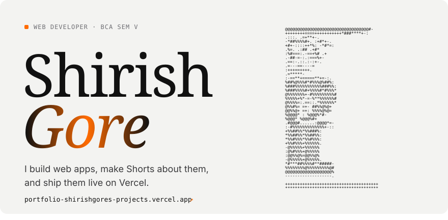
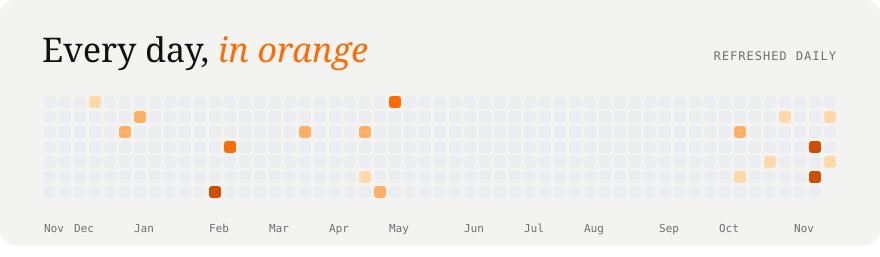
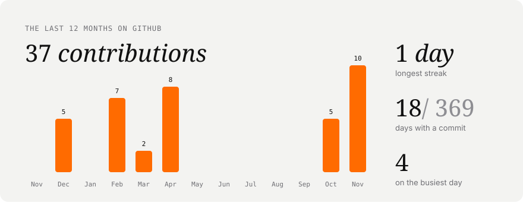
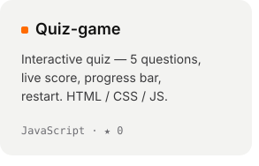
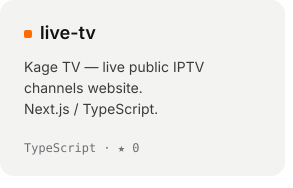
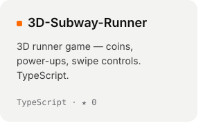

<!-- Mixed profile: Avi-style cards + old terminal style.
     Cards in ./cards/ are drawn by scripts/build_avi_style_cards.py, with
     Shirish's own info and real numbers only. Terminal sections are the
     old green style. Bug fixes vs the old README:
     - github-readme-stats: dropped include_all_commits + count_private
       (those params made it fail with "Could not fetch total commits")
     - Sport-question-bank- repo is empty on GitHub, so SportStudy Pro
       links to its live site only, not to that empty repo
     - stats username is shirishgore (no space) everywhere -->
<div align="center">
<a href="https://portfolio-shirishgores-projects.vercel.app/"></a><br>
</div>

```bash
shirish@github:~$ whoami
```

### 👨‍💻 About Me

- 🎓 **BCA Semester V [NEP]** — Shree Hanuman Vyayam Prasarak Mandal's Degree College of Physical Education (Multifaculty Autonomous College), Amravati · 2024–2027
- 💻 **Web Developer** — I build and ship full-stack web apps, from idea to live on Vercel
- 🚀 **Currently building** — SportStudy Pro, Live TV (Kage TV), ConvertHub & Kage Shorts
- 🎯 **Open to Work** — Web Development Internship / Junior Web Developer
- 📍 Amravati, Maharashtra, India

```bash
shirish@github:~$ ./skills.sh
```

### 🛠️ Tech Stack


<div align="center">
<br>
<br>
<a href="https://portfolio-shirishgores-projects.vercel.app/"></a><a href="https://www.youtube.com/@KageShorts-x2x"></a><a href="https://www.linkedin.com/in/shirish-gore"></a><br>
</div>

```bash
shirish@github:~$ ./projects.sh
```

### 📌 Pinned Projects

| Project | What it is | Live |
|---|---|---|
| **SportStudy Pro** | Sports Question Bank — accounts, question sets, PDF paper generation (Questions Only / Questions + Answers). Flask + SQLite. Led a 4-member team. | [Live Site](https://sports-question-bank-application.vercel.app/) |
| **Quiz Game** | Interactive quiz — 5 questions, 4 options each, live score, progress bar, restart. HTML / CSS / JavaScript. | [Repo](https://github.com/shirishgore/Quiz-game) |
| **Live TV — Kage TV** | Live public IPTV channels website (Next.js). | [Live Site](https://live-tv-puce.vercel.app/) |
| **ConvertHub** | PDF / video / audio converter — 57 tools, all in-browser. | [Live Site](https://converthub-tools.vercel.app/) |
| **3D Subway Runner** | 3D runner game — coins, power-ups, swipe controls. | [Live Site](https://3-d-subway-runner.vercel.app/) |
| **Digital Store** | edit.with_harsh.fit — my original PDF guides store. | [Live Site](https://editwithharshfit.vercel.app/) |

<div align="center">
<picture><source media="(prefers-color-scheme: dark)" srcset="./cards/title-coding-dark.svg" /></picture><br>
<a href="https://github.com/shirishgore/Quiz-game"></a><a href="https://github.com/shirishgore/live-tv"></a><a href="https://github.com/shirishgore/3D-Subway-Runner"></a>
</div>

```bash
shirish@github:~$ ./contributions.sh
```

### 📊 GitHub Stats

<div align="center">


</div>

```bash
shirish@github:~$ ./links.sh
```

### 🌐 Find Me

- 🌐 **Portfolio:** https://portfolio-shirishgores-projects.vercel.app/
- 💼 **LinkedIn:** https://www.linkedin.com/in/shirish-gore
- 📸 **Instagram:** https://www.instagram.com/edit.with_harsh.fit
- 🎬 **YouTube — Kage Shorts:** https://www.youtube.com/@KageShorts-x2x
- ✉️ **Email:** shirishgore1@gmail.com

---

<div align="center">


[](https://buymeacoffee.com/Shirish_Gore)

**`$ echo "Catch you on the next build."`**

</div>

<p align="center">
<a href="https://portfolio-shirishgores-projects.vercel.app/">portfolio</a> &nbsp;/&nbsp; <a href="https://www.linkedin.com/in/shirish-gore">linkedin</a> &nbsp;/&nbsp; <a href="https://www.instagram.com/edit.with_harsh.fit">instagram</a> &nbsp;/&nbsp; <a href="https://www.youtube.com/@KageShorts-x2x">youtube</a>
</p>
